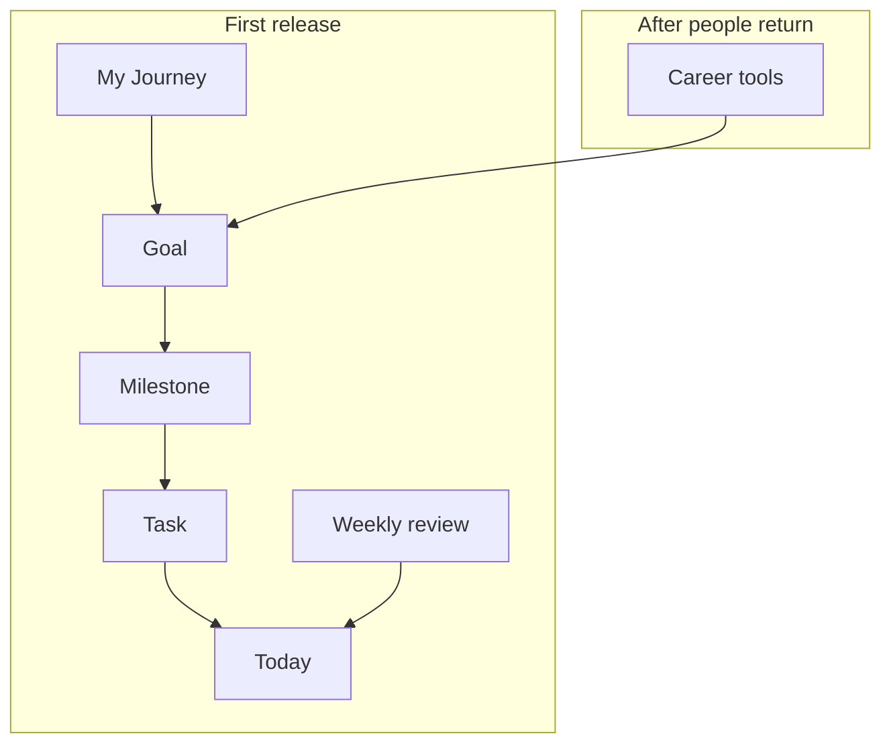
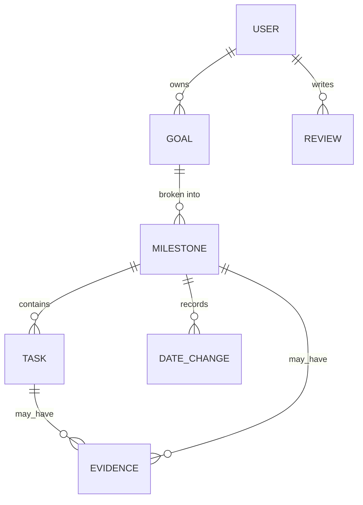
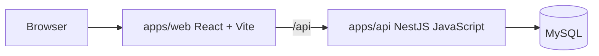

# Progression build plan

This is the plan to build from. [progression-product-plan.md](../progression-product-plan.md) stays the long vision. This file cuts that vision down to a first product that can be understood, built, and used.

Words used here are defined in [CONTEXT.md](../CONTEXT.md).

## The product

Progression helps a person turn one meaningful goal into a milestone, a next action, and a way to continue after a week goes badly.

**Pitch:** Plan the life you want, and keep moving toward it one finished milestone at a time.

The first release is that execution engine. A category such as Career is a label on a goal. Career tools (applications, resumes, interviews) wait until people are coming back weekly. See [ADR 0001](adr/0001-first-release-is-the-execution-engine.md).

## The picture

A person always has one life plan: the set of goals they can see on My Journey. They can work on more than one goal at once. Nothing is locked behind another goal.

## First session

1. Create an account.
2. Name one goal, why it matters, and what success looks like.
3. Accept or edit one suggested milestone, including a sentence that says when it is done.
4. Keep a few tasks. Land on Today with one next action.

Category, extra goals, and weekly hours can wait until the second visit.

## Screens

| Screen | Question it answers |
|---|---|
| Today | What should I do next? |
| My Journey | What goals am I moving, and in what order? |
| Goal | Why this goal exists, which milestone is current, and what is coming after it |
| Milestone | What “done” means, which tasks remain, and any note or link |
| Weekly review | What happened, and what is the focus next week? |
| Settings | Account, timezone, sign out |

There is no Library, Insights, or Workspaces item in the first navigation. Those names were in the vision and were not specified as screens.

## What ships

- Account, sign in, and a private record for each person
- One life plan, made of the person’s goals
- Goals with title, why, outcome, category label, order, and optional target date
- Status for a goal: active, paused, completed
- Milestones with a completion sentence, order, optional target date, and status: planned, current, completed, abandoned
- One current milestone per goal
- One-time tasks: open or done, with an optional due date
- Today, across active goals only
- Pause and resume a goal. Paused goals leave Today and stay on My Journey
- Change a milestone date. Keep the previous date and a short reason
- Complete a milestone only when the person says the completion sentence is met. Finishing tasks does not finish the milestone
- A note or a link on a task or milestone
- A weekly review: what happened, what to drop, and next week’s focus
- Counts, not a percentage: milestones completed, tasks done this week
- Export of the person’s goals, milestones, tasks, and reviews

## What waits

- Career workspace: companies, applications, resumes, contacts, interviews
- Other workspaces: business, learning, finance, health
- Recurring tasks, routines, and time blocks
- Goal dependencies and locked future goals
- More than one life plan
- File uploads
- Progress percentages
- Insights, forecasting, and plan simulation
- AI suggestions
- Reminders, calendar sync, sharing, and billing

A percentage waits until the formula is written down: weights, skipped work, deleted milestones, and whether optional tasks count. Until then the product shows counts.

## Domain shape

There is no `life_plans` table. The life plan is every goal that belongs to the user.

A goal category is a label: career, business, learning, finance, health, communication, relocation, personal, or custom. It does not create extra tables.

Deleting a goal is not in the first release. Pausing and abandoning a milestone cover “this is no longer the plan” without throwing history away.

Dates are calendar dates. “Today” uses the timezone on the user, and UTC until they set one.

## System

The running app follows the setup blueprint, not the Next.js and TypeScript API named in the vision doc. See [ADR 0002](adr/0002-keep-the-blueprint-stack.md).

| Piece | Choice |
|---|---|
| UI | `apps/web`, React, TypeScript, Vite. Page choice lives in `App.tsx` |
| API | `apps/api`, NestJS, JavaScript. Global prefix `/api` |
| Data | MySQL, Sequelize, migrations in `apps/api/migrations` |
| Auth | JWT bearer token, stored in the browser, checked on the server |
| Queue | Redis and BullMQ stay in the scaffold. No job is required for the first release |

Intended local ports are API `6000` and web `5173`. On this machine those host ports for MySQL, Redis, and the web app were already taken, so Compose and Vite use MySQL `3307`, Redis `6380`, and web `5174`.

### API modules

Each feature is a folder under `apps/api/src/modules`, registered from `src/modules/index.js`.

| Module | Responsibility |
|---|---|
| `auth` | Register, sign in, current user |
| `goals` | Life plan list, create, edit, reorder, pause, resume, complete |
| `milestones` | Stages, current milestone, date changes, abandon, complete |
| `tasks` | Actions on a milestone, including a note or link |
| `reviews` | Weekly review |
| `export` | One download of the person’s records |

The web app gets one page file per screen and calls `/api/...` through `src/lib/api.ts`.

Authorization is always on the server: a person can read and change only their own rows.

## Build order

1. **Accounts.** A person can register and sign in.
2. **Goals.** My Journey lists, creates, reorders, pauses, and resumes goals.
3. **Milestones and tasks.** A goal has one current milestone and its tasks.
4. **Today.** Active goals contribute their open tasks. One action is highlighted.
5. **Close the loop.** Finish a task, finish a milestone against its sentence, change a date with a reason, add a note or link.
6. **Review and export.** Weekly review, then a data export.

Stop after step 5 and use it before adding career tools. The exit test is: a new person creates a goal, completes a task, completes a milestone, and writes what next week is for.

## How this differs from the vision doc

The vision doc is still the right long-term direction: universal goals, optional workspaces, recovery instead of shame, evidence instead of streaks. The first build does not include every must-have in that doc at once. Career, recurrence, dependencies, insights, and percentages are sequenced behind the habit of coming back.
